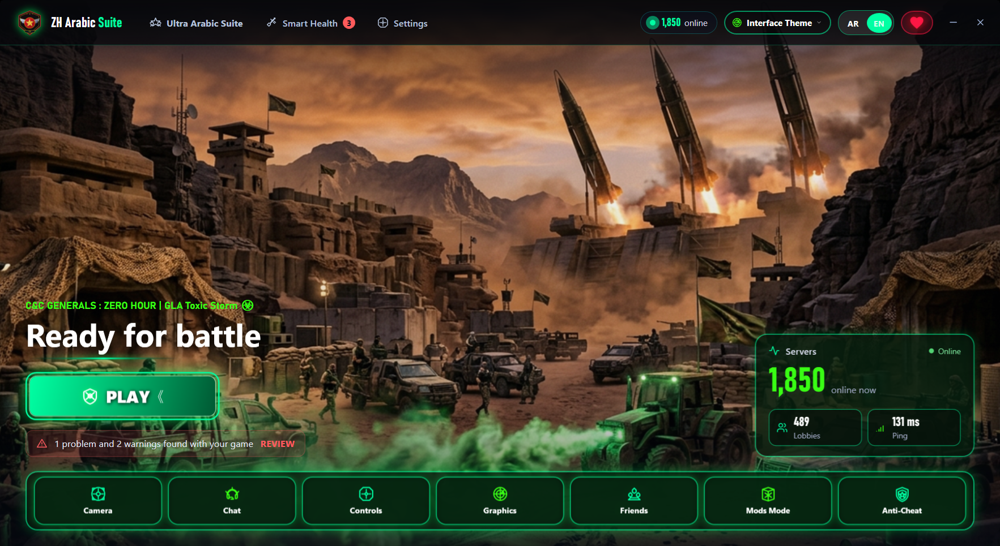

# 🎖️ ZH Arabic Suite — Advanced Alternative Launcher for Generals Online

**ZH Arabic Suite** is a full-featured **alternative launcher for Generals Online**, combining a modern tactical game launcher, real-time in-game chat suite, smart health diagnostics, and optional localization tools for **Command & Conquer: Generals – Zero Hour**.

---

## 🚀 Quick Download & Installation

1. 📥 [**Download Setup Installer: ZHArabicSuite_Setup_v1.0.1.exe**](https://github.com/Tech2442/ZHArabicSuite-Releases/releases/download/v1.0.1/ZHArabicSuite_Setup_v1.0.1.exe) (~123 MB)
2. 📦 [**Download Arabic Voice Pack (Optional): PackageData.enc**](https://github.com/Tech2442/ZHArabicSuite-Releases/releases/download/v1.0.1/PackageData.enc) (~543 MB)

> [!IMPORTANT]
> **Important Notes:**
> - **Alternative Launcher for Generals Online:** `ZH Arabic Suite` serves as a complete **alternative launcher for Generals Online** — allowing you to launch the game, view live server & player counts, configure all Generals Online settings, and manage anti-cheat plugins directly.
> - **About the Attached Package (`PackageData.enc`):** The attached package (`PackageData.enc`) contains the **Arabic voice-over (audio dubbing) files and is intended for Arab users only**. It is **completely independent of the application** — you can install and use `ZH Arabic Suite` normally without downloading or including `PackageData.enc`.

---

## 🌟 Key Specifications & Features

* **Complete Alternative Launcher for Generals Online:**
  * Directly replaces the default **Generals Online** launcher while maintaining 100% compatibility with Generals Online servers, live player statistics, lobbies, and **Command & Conquer: Generals – Zero Hour**.
  * Manage camera height, graphics, windowed/borderless resolution, frame rate limits, social notifications, community data patches, and anti-cheat plugins in one unified interface.
* **Bilingual Interface (English & Arabic):**
  * Defaults to **English (`EN`)** out of the box, with instant live switching between **English** and **Arabic (`AR`)**.
* **Modern In-Game Chat Suite (Optional — Disabled by Default):**
  * **Live Voice Typing (Push-to-Talk):** Hold the microphone icon to transcribe your speech into the chat box in real time without sending until you press `Enter`.
  * **Instant AI Chat Translation:** Translate your chat messages on the fly into any world language with a single click before sending.
  * **Quick Tactical Phrases & Emoticons:** One-click customizable tactical callouts and in-game supported symbols.
  * **Connected Arabic Text Rendering:** Properly shapes and connects right-to-left Arabic script inside the classic game engine for all players.
  * **Customizable Hotkeys:** Freely configure the keys used to open the chat bar and send messages.
* **Smart Health & Diagnostics:**
  * Automatic verification and repair of game files, display settings, firewall rules, Documents path, and online synchronization to prevent online **Mismatch** errors.
* **Three Faction UI Themes:**
  * Switch dynamically between three custom military interface themes: **China (Nuclear Dragon)**, **USA (Cyber Laser)**, and **GLA (Toxic Storm)**.
* **Arabic Localization Suite (Optional — For Arab Users):**
  * Optional Arabic text localization (Standard, Enhanced, and Dynamic CSF Engine) and dual Arabic voice-over modes (Normal & Matched) with automatic restore of original files when exiting the game.

---

## 📞 Community & Official Channels
- 📺 **Official YouTube Channel:** [Tech2442 on YouTube](https://www.youtube.com/tech2442)
- ✈️ **Official Telegram Channel:** [Tech2442 on Telegram](https://t.me/+F5ezKUYFAARjNmNk)
